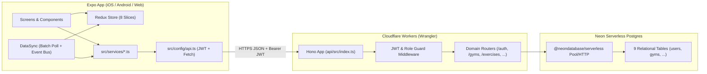
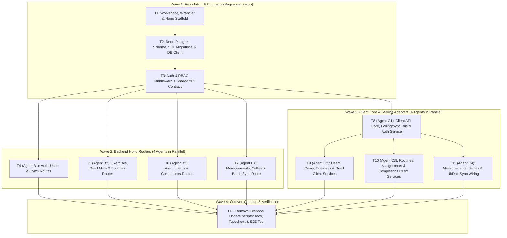

# Firebase → Hono (Cloudflare Workers / Wrangler) + Neon Postgres Migration Plan

## 1. Executive Summary & Target Architecture

We are migrating **GymTrack** off **Firebase Authentication + Firebase Realtime Database (RTDB)** to a **100% Free-Tier Serverless Stack**:

- **API Layer**: **Hono** running on **Cloudflare Workers** (managed & deployed via **Cloudflare Wrangler**).
- **Database Layer**: **Neon Serverless Postgres** (`@neondatabase/serverless` over HTTP/WebSocket edge driver, optionally paired with **Drizzle ORM** for type-safe SQL & migrations).
- **Authentication Layer**: Stateless **JWT / Session Token Auth** implemented directly in Hono (`hono/jwt` + Web Crypto PBKDF2/Scrypt password hashing, native to Cloudflare Workers with zero Node.js native-addon bloat) persisted on the client in `AsyncStorage` (native) / `localStorage` (web).
- **Client Sync & Service Layer**: Drop-in replacement of `src/services/*.ts` and `src/components/DataSync.tsx` using a central typed HTTP client (`src/config/api.ts`) + lightweight polling / mutation-triggered revalidation (or `/api/sync` batch endpoint) so **all Redux slices, selectors, and UI screens remain 100% untouched**.

---

## 2. Blast Radius Analysis (From Knowledge Graph)

Based on the `graphify` dependency analysis, Firebase is strictly isolated to **14 files**:

1. `package.json` (`firebase` dependency & `deploy:web` script)
2. `src/config/firebase.ts` (SDK initialization & `isFirebaseConfigured`)
3. `src/services/auth.ts` (Auth + `users/{uid}` profile bootstrap/mutations)
4. `src/services/users.ts` (`users` & `users/{uid}` subscriptions)
5. `src/services/gyms.ts` (`gyms` & `gymCodes` CRUD + subscriptions)
6. `src/services/exercises.ts` (`exercises` CRUD + subscription)
7. `src/services/routines.ts` (`routines/{coachId}` CRUD + `assignRoutine` / `unassignRoutine` batch writes)
8. `src/services/assignments.ts` (`assignments/{dateKey}` CRUD + subscription)
9. `src/services/completions.ts` (`completions/{uid}/{dateKey}/{taskId}` toggle + subscriptions)
10. `src/services/measurements.ts` (`measurements/{uid}` CRUD + subscription)
11. `src/services/selfies.ts` (`selfies/{uid}` CRUD + subscription)
12. `src/utils/defaultExercises.ts` (`meta/exerciseSeedVersion` + starter exercise seeding)
13. `src/components/DataSync.tsx` (wires `subscribeTo*` to Redux `*Updated` actions)
14. Minor config references in `src/navigation/RootNavigator.tsx`, `src/screens/LoginScreen.tsx`, and `src/screens/shared/ProfileScreen.tsx`

> **Key Architectural Advantage**: Because all 8 Redux slices (`auth`, `members`, `gyms`, `exercises`, `routines`, `assignments`, `completions`, `measurements`, `selfies`) normalize raw records via `*Updated` actions, preserving the function signatures in `src/services/*.ts` means **zero UI or Redux selector rewrites** are needed.

---

## 3. Postgres Schema Design (NeonDB)

All timestamps (`created_at`, `completed_at`, `taken_at`) are stored as `BIGINT` (epoch ms) to match `number` in `src/types/index.ts` without date-serialization drift.

| Table | Primary Key | Columns & Types | Security / Access Equivalent (`database.rules.json`) |
| :--- | :--- | :--- | :--- |
| `gyms` | `id TEXT PRIMARY KEY` | `name TEXT NOT NULL`, `coach_code TEXT NOT NULL`, `created_at BIGINT NOT NULL` | Public read (`id, name, created_at`); `coach_code` only readable/writable by `admin` |
| `users` | `uid TEXT PRIMARY KEY` | `name TEXT NOT NULL`, `email TEXT UNIQUE NOT NULL`, `password_hash TEXT NOT NULL`, `role TEXT NOT NULL CHECK (role IN ('admin','coach','member'))`, `gym_id TEXT REFERENCES gyms(id) ON DELETE SET NULL`, `coach_id TEXT REFERENCES users(uid) ON DELETE SET NULL`, `photo_data TEXT`, `created_at BIGINT NOT NULL` | Authenticated read; self can update `name`, `photo_data`, `password_hash`; `admin` can update `role`, `gym_id`, `coach_id`; coach signup verifies `gyms.coach_code` |
| `exercises` | `id TEXT PRIMARY KEY` | `name TEXT NOT NULL`, `type TEXT NOT NULL`, `description TEXT`, `image_url TEXT`, `video_url TEXT`, `met DOUBLE PRECISION`, `suggested_order INTEGER`, `metric_fields JSONB NOT NULL`, `created_by TEXT NOT NULL`, `created_at BIGINT NOT NULL` | Authenticated read; `coach` or `admin` write |
| `routines` | `id TEXT PRIMARY KEY` | `coach_id TEXT NOT NULL REFERENCES users(uid) ON DELETE CASCADE`, `name TEXT NOT NULL`, `items JSONB NOT NULL`, `created_at BIGINT NOT NULL` | Owner `coach` (`coach_id = auth.uid`) or `admin` read/write |
| `assignments` | `id TEXT PRIMARY KEY` | `date_key TEXT NOT NULL`, `exercise_id TEXT NOT NULL`, `member_id TEXT NOT NULL`, `coach_id TEXT NOT NULL`, `metrics JSONB NOT NULL`, `notes TEXT`, `routine_id TEXT`, `routine_name TEXT`, `created_at BIGINT NOT NULL` (Index on `(date_key)`, `(member_id, date_key)`, `(date_key, routine_id, member_id)`) | Authenticated read; `coach` or `admin` write |
| `completions` | `(uid, date_key, task_id)` | `uid TEXT NOT NULL`, `date_key TEXT NOT NULL`, `task_id TEXT NOT NULL`, `completed_at BIGINT NOT NULL` | Authenticated read (`coach`/`admin` read all; `member` reads own); owner `uid = auth.uid` write/delete |
| `measurements` | `id TEXT PRIMARY KEY` | `uid TEXT NOT NULL REFERENCES users(uid) ON DELETE CASCADE`, `date_key TEXT NOT NULL`, `weight_kg DOUBLE PRECISION`, `chest_cm DOUBLE PRECISION`, `waist_cm DOUBLE PRECISION`, `arm_cm DOUBLE PRECISION`, `thigh_cm DOUBLE PRECISION`, `notes TEXT`, `created_at BIGINT NOT NULL` | Owner `uid = auth.uid` read/write |
| `selfies` | `id TEXT PRIMARY KEY` | `uid TEXT NOT NULL REFERENCES users(uid) ON DELETE CASCADE`, `date_key TEXT NOT NULL`, `photo_data TEXT NOT NULL`, `notes TEXT`, `taken_at BIGINT NOT NULL`, `created_at BIGINT NOT NULL` | Owner `uid = auth.uid` read/write |
| `app_meta` | `key TEXT PRIMARY KEY` | `value JSONB NOT NULL`, `updated_at BIGINT NOT NULL` | Replaces `meta/exerciseSeedVersion` |

---

## 4. Parallel Execution Strategy for Agents & Subagents

To maximize concurrency without git merge conflicts or file collisions, the work is divided into **5 Waves** and **Parallel Agent Tracks**. Every task and subtask below has **strictly disjoint file ownership**.

> **Note**: Wave 2 (Backend Hono Routers `T4`–`T7`) and Wave 3 (`T8` and then `T9`–`T11`) can even run **simultaneously** once `T3` (the shared API contract & auth middleware spec) is locked! That allows up to **8 subagents working concurrently**.

---

## 5. Detailed Tasks & Subtasks Breakdown

### Wave 1: Foundation, Database Schema & Shared Contracts

#### Task `T1` — Workspace, Cloudflare Wrangler & Hono Scaffold
- **Goal**: Set up the Cloudflare Worker Hono backend structure (`api/` or `worker/`) and Wrangler configuration alongside the Expo app without breaking Metro bundler or Expo TypeScript checks.
- **File Ownership**:
  - `wrangler.toml` (or `wrangler.jsonc`)
  - `api/tsconfig.json`
  - `api/src/index.ts`
  - `api/src/types.ts`
  - `package.json` (scripts & dependencies: `hono`, `@neondatabase/serverless`, `wrangler`, `@cloudflare/workers-types`)
- **Subtasks**:
  - **`T1.1`**: Install/verify `hono`, `@neondatabase/serverless`, and `wrangler` dev dependencies; add `api:dev`, `api:deploy`, `db:migrate` scripts to `package.json`.
  - **`T1.2`**: Create `wrangler.toml` with Cloudflare Workers compatibility flags (`nodejs_compat` if needed), environment variable bindings (`DATABASE_URL`, `JWT_SECRET`, `CORS_ORIGIN`), and `api/tsconfig.json`.
  - **`T1.3`**: Create `api/src/types.ts` defining Hono `Bindings` (`DATABASE_URL`, `JWT_SECRET`) and `Variables` (`user: { uid: string; email: string; role: Role }`), plus `api/src/index.ts` entrypoint with CORS, healthcheck (`GET /api/health`), and route mounting stubs.

#### Task `T2` — Neon Postgres Schema, SQL Migrations & DB Helper
- **Goal**: Define the 9 Postgres tables in NeonDB, SQL migration files, and the serverless Neon query helper for Cloudflare Workers.
- **File Ownership**:
  - `api/db/schema.sql`
  - `api/src/db/client.ts`
  - `api/src/db/mappers.ts`
- **Subtasks**:
  - **`T2.1`**: Author `api/db/schema.sql` with idempotent `CREATE TABLE IF NOT EXISTS` statements and indexes for `gyms`, `users`, `exercises`, `routines`, `assignments`, `completions`, `measurements`, `selfies`, and `app_meta`.
  - **`T2.2`**: Implement `api/src/db/client.ts` wrapping `neon(env.DATABASE_URL)` (and transaction helper `Pool` from `@neondatabase/serverless` for multi-statement atomic operations like `assignRoutine` and coach registration).
  - **`T2.3`**: Implement `api/src/db/mappers.ts` converting snake_case Postgres rows (`gym_id`, `coach_id`, `photo_data`, `created_at`, `metric_fields`, etc.) to exact camelCase `src/types/index.ts` shapes (`UserProfile`, `Gym`, `Exercise`, `Routine`, `Assignment`, `Completion`, `Measurement`, `DailySelfie`) and RTDB-compatible record maps (`Record<string, ...>`).

#### Task `T3` — Edge Auth (JWT + WebCrypto Password Hashing) & RBAC Middleware
- **Goal**: Replace Firebase Auth & `database.rules.json` with Hono middleware enforcing authentication and role-based access control (`admin`, `coach`, `member`).
- **File Ownership**:
  - `api/src/utils/crypto.ts`
  - `api/src/middleware/auth.ts`
  - `src/types/api.ts` (shared request/response contract between Hono and Expo client)
- **Subtasks**:
  - **`T3.1`**: Implement `api/src/utils/crypto.ts` using Cloudflare Web Crypto API (`crypto.subtle` PBKDF2-SHA256) for password hashing/verification and `hono/jwt` for signing/verifying JWT access tokens.
  - **`T3.2`**: Implement `api/src/middleware/auth.ts` with `requireAuth`, `requireRole('admin' | 'coach')`, and `requireSelfOrRole(paramKey, ['admin'])` middleware matching every rule in `database.rules.json`.
  - **`T3.3`**: Create `src/types/api.ts` documenting every REST endpoint path, request payload, response shape, and error code (`auth/invalid-coach-code`, `auth/wrong-password`, `auth/email-already-in-use`, `auth/invalid-credential`, etc.) so backend and frontend agents can build against a frozen contract in parallel.

---

### Wave 2: Backend Hono Domain Routers (4 Parallel Subagents)

Each subagent owns its own route files in `api/src/routes/`. After all 4 finish, they are wired into `api/src/index.ts`.

#### Task `T4` (Agent B1) — Auth, Users & Gyms Routes
- **File Ownership**:
  - `api/src/routes/auth.ts`
  - `api/src/routes/users.ts`
  - `api/src/routes/gyms.ts`
- **Subtasks**:
  - **`T4.1` (`api/src/routes/auth.ts`)**:
    - `POST /api/auth/register`: Validate email/password; if `role === 'coach'`, atomically verify `coachCode` against `gyms.coach_code` for `gymId` (returning `{ code: 'auth/invalid-coach-code' }` with HTTP 403 on mismatch); insert user into `users`; return `{ token, profile }`.
    - `POST /api/auth/login`: Verify email & password hash (returning `{ code: 'auth/invalid-credential' }` on failure); return `{ token, profile }`.
    - `GET /api/auth/me`: Return current `UserProfile` (or create default member profile if needed).
    - `POST /api/auth/change-password`: Verify `currentPassword` (returning `{ code: 'auth/wrong-password' }` on mismatch) and update `password_hash`.
  - **`T4.2` (`api/src/routes/users.ts`)**:
    - `GET /api/users`: (`coach` or `admin`) Return `Record<string, UserProfile>`.
    - `GET /api/users/:uid`: (`self`, `coach`, or `admin`) Return single `UserProfile`.
    - `PATCH /api/users/:uid`: If `admin`, allow updating `role`, `gymId`, `coachId`, `name`, `photoData`; if `self`, allow updating `name` and `photoData` (`null` clears column).
  - **`T4.3` (`api/src/routes/gyms.ts`)**:
    - `GET /api/gyms`: Publicly readable (needed on SignUpScreen before auth) — returns `Record<string, Gym>` (without `coach_code`).
    - `POST /api/gyms`: (`admin`) Create gym + generate initial `coach_code`.
    - `PATCH /api/gyms/:id`: (`admin`) Rename gym.
    - `DELETE /api/gyms/:id`: (`admin`) Delete gym.
    - `GET /api/gyms/:id/code` & `POST /api/gyms/:id/code/regenerate`: (`admin`) Read or regenerate `coach_code`.

#### Task `T5` (Agent B2) — Exercises, Seed Meta & Routines Routes
- **File Ownership**:
  - `api/src/routes/exercises.ts`
  - `api/src/routes/routines.ts`
- **Subtasks**:
  - **`T5.1` (`api/src/routes/exercises.ts`)**:
    - `GET /api/exercises`: (authenticated) Return `Record<string, Exercise>`.
    - `POST /api/exercises`: (`coach` | `admin`) Create exercise (accept optional deterministic `id` for default exercise seeding, or generate ID).
    - `PATCH /api/exercises/:id`: (`coach` | `admin`) Partial update of exercise fields.
    - `DELETE /api/exercises/:id`: (`coach` | `admin`) Delete exercise.
    - `POST /api/exercises/seed`: (`coach` | `admin`) Server-side or batch endpoint supporting `ensureDefaultExercises` (`app_meta.exerciseSeedVersion`, deduplicating/repointing assignments, and upserting starter exercises in a single transaction).
  - **`T5.2` (`api/src/routes/routines.ts`)**:
    - `GET /api/routines/:coachId`: (owner `coach` or `admin`) Return `Record<string, Routine>`.
    - `POST /api/routines/:coachId` & `PUT /api/routines/:coachId/:routineId`: Save/update routine.
    - `DELETE /api/routines/:coachId/:routineId`: Delete routine.
    - `POST /api/routines/:coachId/:routineId/assign`: (`coach` | `admin`) Transactional replacement of `assignRoutine` (deletes prior assignments for `(dateKey, routineId, memberId)` and inserts new ordered assignments `now + index`).
    - `POST /api/routines/:coachId/:routineId/unassign`: (`coach` | `admin`) Transactional delete of assignments matching `(dateKey, routineId, memberId)`.

#### Task `T6` (Agent B3) — Assignments & Completions Routes
- **File Ownership**:
  - `api/src/routes/assignments.ts`
  - `api/src/routes/completions.ts`
- **Subtasks**:
  - **`T6.1` (`api/src/routes/assignments.ts`)**:
    - `GET /api/assignments`: (authenticated) Return `AssignmentsByDate` (`Record<dateKey, Record<id, Assignment>>`).
    - `POST /api/assignments`: (`coach` | `admin`) Create assignment.
    - `PATCH /api/assignments/:dateKey/:assignmentId`: (`coach` | `admin`) Update metrics or notes (`notes: null` clears notes).
    - `DELETE /api/assignments/:dateKey/:assignmentId`: (`coach` | `admin`) Delete assignment.
  - **`T6.2` (`api/src/routes/completions.ts`)**:
    - `GET /api/completions`: (`coach` | `admin`) Return full `CompletionsByUser` (`Record<uid, Record<dateKey, Record<taskId, { completedAt }>>>`).
    - `GET /api/completions/:uid`: (`self` | `coach` | `admin`) Return `CompletionsByDate` (`Record<dateKey, Record<taskId, { completedAt }>>`).
    - `PUT /api/completions/:uid/:dateKey/:taskId`: (`self`) Upsert `{ completedAt: Date.now() }` when `done: true`, or `DELETE` row when `done: false`.

#### Task `T7` (Agent B4) — Measurements, Selfies & Batch Sync Route
- **File Ownership**:
  - `api/src/routes/measurements.ts`
  - `api/src/routes/selfies.ts`
  - `api/src/routes/sync.ts`
- **Subtasks**:
  - **`T7.1` (`api/src/routes/measurements.ts`)**:
    - `GET /api/measurements/:uid`: (`self` | `coach` | `admin`) Return `Record<string, Measurement>`.
    - `POST /api/measurements/:uid`: (`self`) Create measurement entry.
    - `PUT /api/measurements/:uid/:id`: (`self`) Update measurement entry preserving `createdAt`.
    - `DELETE /api/measurements/:uid/:id`: (`self`) Delete measurement entry.
  - **`T7.2` (`api/src/routes/selfies.ts`)**:
    - `GET /api/selfies/:uid`: (`self` | `coach` | `admin`) Return `Record<string, DailySelfie>`.
    - `POST /api/selfies/:uid`: (`self`) Create selfie entry.
    - `PUT /api/selfies/:uid/:id`: (`self`) Update selfie entry preserving `createdAt`.
    - `DELETE /api/selfies/:uid/:id`: (`self`) Delete selfie entry.
  - **`T7.3` (`api/src/routes/sync.ts`)**:
    - `GET /api/sync`: Single round-trip endpoint tailored to `DataSync.tsx`! Based on the caller's JWT role (`admin`, `coach`, `member`), runs parallel queries on Neon and returns `{ assignments, exercises, gyms, users?, routines?, completions?, measurements?, selfies?, coachProfile? }` in one HTTP response to minimize Cloudflare Worker invocations and Neon compute time.

---

### Wave 3: Frontend API Client, Sync Engine & Service Adapters (4 Parallel Subagents)

#### Task `T8` (Agent C1) — Client API Core, Polling/Revalidation Bus & Auth Service
- **File Ownership**:
  - `src/config/api.ts` (replaces `src/config/firebase.ts`)
  - `src/config/firebase.ts` (temporary compatibility re-export of `isApiConfigured as isFirebaseConfigured` until Wave 4 cleanup)
  - `src/services/auth.ts`
- **Subtasks**:
  - **`T8.1` (`src/config/api.ts`)**:
    - Configure `API_BASE_URL` from `process.env.EXPO_PUBLIC_API_URL`.
    - Export `isApiConfigured` (and alias `isFirebaseConfigured` for backward compatibility).
    - Manage JWT storage in `AsyncStorage` (`@gymtrack/jwt`), attach `Authorization: Bearer <token>` on requests, and provide a lightweight pub/sub invalidation emitter (`emitSyncInvalidate(channel)` / `createPoller(channel, fetcher, intervalMs)`) so any mutation immediately triggers a fresh fetch in active subscribers.
  - **`T8.2` (`src/services/auth.ts`)**:
    - Preserve exact exported function signatures: `authErrorMessage`, `signIn`, `registerAccount`, `signOutAccount`, `listenToAuth`, `fetchOrCreateProfile`, `updateUserProfile`, `updateUserDisplayName`, `updateUserPhoto`, `removeUserPhoto`, `changeUserPassword`.
    - Implement an auth state listener registry so `signIn`, `registerAccount`, `signOutAccount`, and profile updates notify `listenToAuth` subscribers just like `onAuthStateChanged`.

#### Task `T9` (Agent C2) — Users, Gyms, Exercises & Seed Client Services
- **File Ownership**:
  - `src/services/users.ts`
  - `src/services/gyms.ts`
  - `src/services/exercises.ts`
  - `src/utils/defaultExercises.ts`
- **Subtasks**:
  - **`T9.1` (`src/services/users.ts`)**: Replace RTDB `onValue` in `subscribeToUsers` and `subscribeToUser` with `createPoller` against `/api/users` and `/api/users/:uid`.
  - **`T9.2` (`src/services/gyms.ts`)**: Replace `subscribeToGyms`, `createGym`, `subscribeToGymCode`, `regenerateGymCode`, `renameGym`, `deleteGym` with calls to `/api/gyms*` and emit sync invalidation after mutations.
  - **`T9.3` (`src/services/exercises.ts` & `src/utils/defaultExercises.ts`)**: Replace `subscribeToExercises`, `createExercise`, `updateExercise`, `deleteExercise`, and `ensureDefaultExercises` with calls to `/api/exercises*` and `/api/exercises/seed`.

#### Task `T10` (Agent C3) — Routines, Assignments & Completions Client Services
- **File Ownership**:
  - `src/services/routines.ts`
  - `src/services/assignments.ts`
  - `src/services/completions.ts`
- **Subtasks**:
  - **`T10.1` (`src/services/routines.ts`)**: Replace `subscribeToRoutines`, `saveRoutine`, `deleteRoutine`, `assignRoutine`, `unassignRoutine` with calls to `/api/routines/:coachId*` (invalidating both `routines` and `assignments` channels on assign/unassign).
  - **`T10.2` (`src/services/assignments.ts`)**: Replace `subscribeToAssignments`, `createAssignment`, `updateAssignment`, `deleteAssignment` with calls to `/api/assignments*`.
  - **`T10.3` (`src/services/completions.ts`)**: Replace `subscribeToCompletions`, `subscribeToAllCompletions`, `setCompletion` with calls to `/api/completions*`.

#### Task `T11` (Agent C4) — Measurements, Selfies & UI/DataSync Wiring
- **File Ownership**:
  - `src/services/measurements.ts`
  - `src/services/selfies.ts`
  - `src/components/DataSync.tsx`
  - `src/screens/shared/ProfileScreen.tsx`
  - `src/screens/LoginScreen.tsx`
  - `src/navigation/RootNavigator.tsx`
- **Subtasks**:
  - **`T11.1` (`src/services/measurements.ts` & `src/services/selfies.ts`)**: Replace `subscribeToMeasurements`, `addMeasurement`, `updateMeasurement`, `deleteMeasurement` and `subscribeToSelfies`, `addSelfie`, `updateSelfie`, `deleteSelfie` with calls to `/api/measurements/:uid*` and `/api/selfies/:uid*`.
  - **`T11.2` (`src/components/DataSync.tsx`)**: Upgrade `DataSync` to use `/api/sync` (or the service subscriptions with `AppState` foreground refresh + mutation revalidation) so Redux receives live updates without Firebase.
  - **`T11.3` (`ProfileScreen.tsx`, `LoginScreen.tsx`, `RootNavigator.tsx`)**: Remove direct `firebaseAuth.currentUser` usage in `ProfileScreen.tsx` (use `fetchOrCreateProfile()` / `getCurrentUser()` from `src/services/auth.ts`) and switch `isFirebaseConfigured` imports to `isApiConfigured` (or keep alias).

---

### Wave 4: Cutover, Cleanup & Verification

#### Task `T12` — Firebase Removal, Env/Docs Update & End-to-End Verification
- **File Ownership**:
  - `package.json`
  - `.env.example`
  - `README.md`
  - Delete obsolete Firebase files (`src/config/firebase.ts`, `database.rules.json`, `firebase.json`, `.firebaserc`) once verified
- **Subtasks**:
  - **`T12.1`**: Remove `firebase` from `package.json`, delete `src/config/firebase.ts` and `database.rules.json`, and update `.env.example` (`EXPO_PUBLIC_API_URL=http://localhost:8787` / Cloudflare Worker URL) and `README.md`.
  - **`T12.2`**: Run `pnpm typecheck` (`tsc --noEmit`), `pnpm lint`, and worker typecheck (`tsc -p api/tsconfig.json --noEmit`) to verify zero TypeScript or lint errors across both Expo and Hono Worker codebases.
  - **`T12.3`**: Run `graphify update .` to update the project knowledge graph and verify all `firebase` nodes and edges are gone and replaced cleanly by the Hono/Neon API layer.
